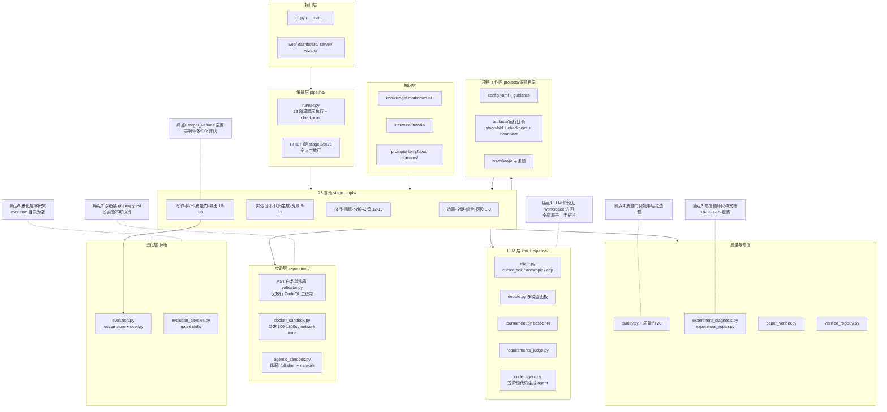
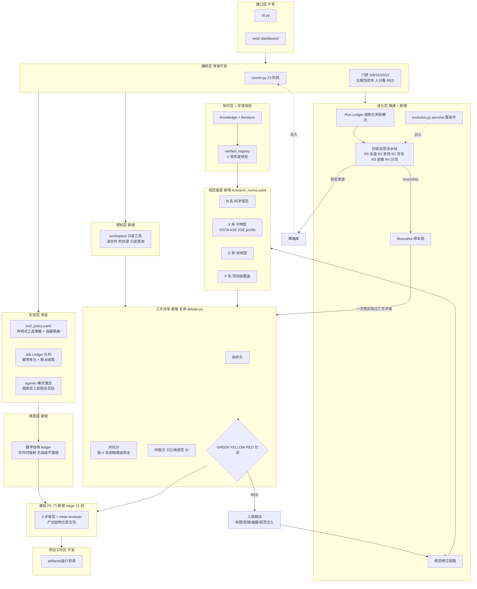

# AutoResearchClaw 自进化改造设计（L2 → L3）

- 整理日期：2026-11-10
- 状态：proposal（待评审；本文档是设计，未开始实现）
- 范围：`researchclaw/` 平台层改造。不改变 python-taint 课题本身的科研计划（那是 [projects/python-taint/docs/05-实施计划.md](../../projects/python-taint/docs/05-实施计划.md) 的事，两者互不阻塞）。
- 来源：2026-11-10 会话讨论（python-taint 进度评估 → 自主性边界分析 → L3 自进化设计 → 三方评审与刊物条件化 → 架构图）整理。

---

## 目录

1. [背景：python-taint 三次运行的实证](#1-背景python-taint-三次运行的实证)
2. [目标分层与验收](#2-目标分层与验收)
3. [架构：现状、目标与组件对照](#3-架构现状目标与组件对照)
4. [模块设计 M1–M9](#4-模块设计)
5. [`research_norms.yaml` 初版内容](#5-research_normsyaml-初版内容)
6. [提示词骨架](#6-提示词骨架)
7. [配置与代码改动清单](#7-配置与代码改动清单)
8. [实施阶段与验收](#8-实施阶段与验收)
9. [风险登记册](#9-风险登记册)
10. [保留给人类的决策清单](#10-保留给人类的决策清单)

---

## 1. 背景：python-taint 三次运行的实证

本设计不来自想象，来自 python-taint 课题三次流水线运行的实测失败。每个痛点都挂着证据位置。

| Run | 结局 | 质量门 | 证据 |
|---|---|---|---|
| `rc-20261109-113024-85fd6e` | stage-10 失败：生成的补全系统被判 MISALIGNED（`static_taint_check` 36 行、`llm_complete_pilot` 26 行的 scaffold） | — | `artifacts/researchclaw-20261109-193020/stage-10/decision.json` |
| `rc-20261110-063213-d02b20`（PyDD） | 18 阶段 done，但指标卡在 `records_parsed=70` 的 degenerate REFINE loop | 6.5/10「insufficient empirical substance for ISSTA/ASE」 | `knowledge/decisions/quality_gate-rc-20261110-063213-d02b20.md` |
| `rc-20261110-073232-688d44`（DART） | 23 阶段 done 但 degraded；实验 harness 报 failed/metrics 空，论文却写了具体数字 | 3.0/10「severe fabrication risk」，表格退化为 `---` | `artifacts/researchclaw-20261110-codeql/degradation_signal.json` |

### 六个痛点

| # | 痛点 | 证据 |
|---|---|---|
| P1 | LLM 阶段无 workspace 访问，全部基于二手描述 | stage-07 综合笔记自述 "could not read codeql_baseline.jsonl … no workspace/shell access" |
| P2 | 沙箱禁 git/pip/pytest，长实验不可执行；单发 300–1800s 预算 | `researchclaw/experiment/validator.py` AST 白名单仅放行 CodeQL 二进制（`allowed_codeql_bins`，`RESEARCHCLAW_CODEQL_BIN`）；指标卡 70 即此因 |
| P3 | 修复循环只改文档措辞，分数震荡 18→56→7→15 | `artifacts/researchclaw-20261110-codeql/experiment_repair_result.json` 的 `cycle_history` |
| P4 | 质量门只能事后拦造假，拦下≠修好 | DART 3.0/10 事故；`_review_publish.py:553-555` 的降级钳位是事后处置 |
| P5 | 进化层零积累：`evolution.py`/`evolution_aevolve.py` 存在但三次 run 的 `evolution/`、`experiment_memory/` 目录全空 | 产物目录实测 |
| P6 | `target_venues` 字段空置（`config.py:883`），无刊物条件化评估；`target_conference` 默认 `neurips_2025`（`config.py:685`）与课题不符 | 配置实测；python-taint 从未填过 |

另一个关键事实：**基础设施的一半零件已经存在**——`AgenticConfig`（Docker 内 Claude Code、full network、自由 shell）、`CodeAgentConfig`（五阶段代码生成）、`debate.py`（多模型面板 + 反驳轮）、`tournament.py`、`requirements_judge.py`、`paper_verifier.py`、`_get_evolution_overlay` 钩子（`_review_publish.py:534`）。本设计大多是**接通与升格**，不是从零造。

---

## 2. 目标分层与验收

| 层 | 定义 | 现状 | 改造后验收 |
|---|---|---|---|
| L1 流程自动 | 23 阶段 full-auto 跑完 | **已达成** | 不回退 |
| L2 工具自主 | agent 能跑真实工具链的长实验（多天、有状态、外部二进制、断点续跑） | 零件有，未接通 | python-taint P1 扩量（383 条差分基线）无人工值守跑完 |
| L3 自进化 | 跨 run 记忆 + 结构化反思 + 策略改进 + 规范演进 | 空壳 | run N 的失败可证明地改变 run N+1 的行为 |

**不可约减的边界**（整个设计的公理）：科学判定不能全自动。三个 LLM 共享训练语料存在共同盲区，三方评审制造的是「可引用、可审计、可复算的裁决 + 分流 95% 常规判定」，不是 ground truth。终态是**人在门禁上的自主循环**，不是无人系统。

### 刻意不变的骨架（任何进化不得绕过）

1. 23 阶段顺序结构（门禁是阶段**之间**的检查点，不是新阶段——新增门禁位 15/22 不改变阶段数与顺序）；
2. `artifacts/<run>/` 作为唯一事实源；
3. markdown 知识库；
4. HITL 门禁的存在本身（放行方式改，存在不改）；
5. 禁用 `simulated` 实验模式（造数会被论文阶段拒绝）。

---

## 3. 架构：现状、目标与组件对照

### 3.1 当前架构（痛点已标注）



### 3.2 优化后架构

新增组件用「新增」标注，改造用「改造」标注：



### 3.3 组件对照表

| 层 | 组件 | 现状 | 改造性质 |
|---|---|---|---|
| 执行 | `validator.py` AST 白名单 | 仅 CodeQL 二进制放行 | **泛化**为 `tool_policy.yaml` 声明式策略 |
| 执行 | `agentic_sandbox.py` | 休眠 | **激活**，承担长实验 |
| 执行 | 单发 300–1800s 沙箱 | 无队列 | **新增** Job Ledger（复用 checkpoint/heartbeat 机制） |
| 感知 | 无 | LLM 无 workspace 访问 | **新增** 只读工具层 |
| 判定 | `debate.py`/`tournament.py`/`requirements_judge.py` | 存在，仅阶段内部用 | **升格**为门禁位三方评审 + 模拟 PC |
| 判定 | `degradation_signal` 事后拦截 | 只能拦不能防 | **前移**为写作时血缘强制 |
| 规范 | 无（`target_venues` 空置） | — | **新增** R/V/D/P 四系 + 版本化治理 |
| 进化 | `evolution.py` + `evolution_aevolve.py` | 存在但零积累 | **并入**：run ledger 取代关键词 lesson 提取，gated skill 并入三方评审 + 人审合入 |
| HITL | 5/9/20 全人工放行 | 逐条人审 | **分流**：机器备证据包，人只裁 RED |

---

## 4. 模块设计

### M1 执行层：工具策略 + Job Ledger + agentic 激活

**目标**：让实验代码能跑真实工具链（git/CodeQL/pip/pytest）的多天长实验，同时安全边界从「逐个二进制放行」升级为「声明式策略 + 容器隔离」。

**`tool_policy.yaml`**（新增，默认策略等价于当前行为，向后兼容）：

```yaml
version: 1
default: deny
container:
  image: researchclaw/sandbox-generic:latest
  network: {pypi: allow, default: deny}   # 网络分区（MVP 实现路径见下注）
tools:
  - name: git
    argv0: [/usr/bin/git]
    allowed_subcommands: [worktree, checkout, show, log, rev-parse]
    writable: [workspace, data/pyvul/snapshots]
  - name: codeql
    argv0: [tools/codeql/codeql]          # 兼容 RESEARCHCLAW_CODEQL_BIN
    allowed_subcommands: [database, analyze, resolve]
  - name: pytest
    writable: [workspace]
audit: {log_invocations_to: run_ledger}   # 每次调用进 run ledger
```

`validator.py` 的 `_is_codeql_invocation` 泛化为 `_is_policy_allowed_invocation`：按 policy 检查 argv[0] + 子命令 + 写路径。**默认策略 = 现状**（只放 CodeQL），所以不开启新配置的课题行为零变化。

**网络分区实现注记**：Docker 没有原生「仅放行 pypi」。两条路径：① **MVP**——预装依赖的沙箱镜像 + `--network none`（零新组件，覆盖绝大多数场景），此路径下 `network` 字段仅作声明不参与 enforcement；② **全量**——内部 pypi 镜像代理 + DNS 级白名单（独立子组件，需要时单独立项）。不给一行配置背后藏一个隐形子系统的假象。

**Job Ledger**（`researchclaw/execution/job_ledger.py`，新增）：

```yaml
unit:
  id: pyvul-diff-0042
  kind: codeql_differential
  idempotency_key: {repo, parent, fix, suite, codeql_version}
  steps: [checkout_parent, database_create, analyze, checkout_fix, ...]
  state: pending | running | done | failed
  checkpoint: per-step           # 复用现有 checkpoint.json 原子写机制
budget: {max_parallel: 2, disk_quota_gb: 40}
```

- 每个单元幂等：按 `idempotency_key` 去重，重跑跳过已完成步骤；
- 崩溃恢复：heartbeat 失联的单元标记 failed 可重入；
- 这恰好就是 python-taint 05 计划 P1 扩量（383 条 × 双快照差分，机器时间约 6h）需要的形态——平台改造与课题推进共用验收。

**agentic 激活（定位修正）**：`AgenticConfig` 已支持容器内 full shell + network。**长实验的主力是 Job Ledger + docker 沙箱批跑**——确定性差分（checkout → database create → analyze × N）不需要 agent，挂上状态回写即可无人值守；agentic 模式只用于 **harness 需要迭代调试**的场景（跑批中实验代码本身要反复修），且同样受 job ledger 调度与审计。AST 沙箱保留给短、自包含、纯 Python 的实验——三类执行形态各司其职。

**实施记录（job_ledger MVP，已落地）**：

- `researchclaw/execution/job_ledger.py`：`Unit` + `JobLedger`（原子写、per-step checkpoint、heartbeat、stale 重置）。
- `researchclaw/experiment/job_ledger_sandbox.py`：把 `experiment.job_ledger.command` 作为 argv 模板执行，占位符 `{python}/{run_dir}/{stage_dir}/{ledger_root}/{project_root}`；日志落文件并只回读尾部；超时按 `timeout_sec`（0 = 不限，长任务不被通用 `time_budget_sec` 截断）；运行期间每 60s 回调一次心跳，避免多天任务被判为流水线卡死。
- 指标口径：**只读账本**，不解析 stdout。`<ledger_root>/metrics.json`（`{"metrics":{...}}` 或扁平数值表）优先，否则取各 unit `summary` 的数值键求均值；`ledger_units_*` 是记账字段，不计入科学指标，Stage 12 也据此拒绝「零实测指标」的运行，防止造假数据流入写作。
- Stage 12（`_execution.py`）新增 `job_ledger` 分支：写 `runs/results.json`（`metrics`/`primary_metric`/`units`/`status_counts`）、`runs/run-1.json`、`stage-12/job_ledger_summary.json`；Stage 13 跳过 Python 精修，REFINE 直接回滚到 Stage 12 复用同一账本续跑（`pipeline/runner.py`）。
- 新增配置：`experiment.mode: job_ledger` + `experiment.job_ledger`（`command` / `ledger_root` / `timeout_sec` / `env` / `log_name`），默认 `command=()` 即不启用，向后兼容。

### M2 感知层：workspace 只读工具

**目标**：修痛点 P1——让 LLM 阶段基于真实数据而非转述工作。

**实施约束与两步走**：现有 LLM 客户端是单发 `chat()` 接口（`debate.py` 等只调 `client.chat`），没有 tool-use 循环，一步到位上 agent loop 是新工程。分两步：

- **B1a 预取模式（先行）**：pipeline 在调用 LLM 前用下述工具**预读**关键 artifact（metric JSON、决策摘要、失败清单），清洗后拼进 prompt——零架构改动即可解 P1 的主要部分；
- **B1b 工具循环（可选，按需）**：仅当预取模式被证明不够（LLM 需要自主决定读什么）时，再基于支持 tools 的 provider 实现 agent loop。

```python
class WorkspaceTools:
    """注入 stage 6/7/8/14 的 LLM 上下文。全部只读、无 shell、输出限幅。"""
    read_file(path, max_bytes) -> str   # 路径必须位于项目根或声明的数据目录
    list_dir(path)
    grep(pattern, glob, limit)
    read_metric(run_id, stage)          # 读结构化 metric，不读原始日志
```

安全护栏：文件内容过 prompt-injection 清洗（指令性文本转义）；每次调用记账（进 run ledger），防止感知轮询变相变成无限读。

### M3 规范基座：`research_norms.yaml`

**目标**：把「科学判定」从自由心证变成可引用、可审计、可复算。

**四层覆盖链**：通用（R）→ 领域（D）→ 刊物（V）→ 项目（P），后者覆盖前者。允许用户自定义改动——但**所有改动进版本化 revision history，且只能人工合入**。

**条目 schema**：

```yaml
- id: R1
  level: general
  statement: 分母纪律：任何比率必须报告分子分母来源，禁止合并不同口径的分母
  check_type: machine | agent | human   # 机器可查 / agent 可查 / 仅人工
  severity: red
  source: "python-taint 65.7% 漏报率被 outside_suite 污染事故（2026-11-10）"
```

**治理**：semver；revision history 记录 {proposer, reason, approver}；V 系条目带 `last_verified`，年度核验挂在 stage 23（citation verify）顺带 web_fetch CFP。

### M4 三方评审（tribunal）

**目标**：在门禁位（stage 5/9/15/20/22）用三角色裁决取代单模型自由评审。**复用 `debate.py`** 的多模型面板 + 反驳轮 + 逐轮 transcript（`debate.py:137` 的 role-model 绑定直接可用）。

| 角色 | 职责 | 约束 |
|---|---|---|
| 辩护方 | 按评审维度组织陈述，逐条挂证据 | 禁止无血缘数字 |
| 对抗方 | 按检查清单攻击：分母、替代解释、外部效度、统计口径 | **必须提出至少一个替代解释**；禁止赞美 |
| 仲裁方 | **只允许引用规范 ID 裁决** | 每个 violation 标注 norm ID + 严重级别；发现规范缺口输出 `norm_gap` 而非自由发挥 |

仲裁方绑定面板里最独立的模型。

**分流路由**：

- **GREEN**：三方一致 + 机器可查规范全过 → 自动放行；
- **YELLOW**：对规范解释有分歧 → 放行 + 分歧原文归档（这份分歧清单是人类的 triage 队列，比裁决本身更有价值）；
- **RED**：R 系冲突 / kill criterion 触发 / 规范本身被质疑 → 停机，人类裁决，附完整证据包。

**优先级规则**：只有 R 系能触发 RED；V 系（刊物期待）最高到 YELLOW，驱动改进优先级而非否决——防「为凑刊物清单牺牲科学性」的作弊路径。

**成本护栏**：评审只在门禁位运行；YELLOW 不升级面板轮转；RED 才全面板 + 反驳轮。

**规范覆盖现状（诚实声明）**：初版 R 系 6 条中 `check_type: machine` 的只有 R2（血缘存在性）与 R4（kill criterion 预注册）——GREEN 分流条件「机器可查规范全过」的实际机器覆盖率很低，GREEN 的可信度上限就是三模型一致性。因此 M9 的 shadow mode 校准是 GREEN 自动放行的**前置条件**，不是可选项。

**norm_gap 分诊预算（防冷启动淹没）**：初期规范覆盖窄，tribunal 几乎每次评审都会产出 norm_gap，而合入只能人工。分诊规则：同一 gap（近似聚类）复现 ≥2 次才进人审队列；每 run 新立规范 ≤2 条；其余 gap 只归档不升级——否则人审队列第一天就被淹没。

**试点节奏**：先只挂 stage 20（质量门）——它是最痛的 P4 点，且已有 judge LLM 报告可做 A/B 对照；裁决质量与 shadow mode 达标后再挂 15（G1 决策预演由 tribunal@15 承担，不依赖模拟 PC），最后扩 5/9/22。

### M5 刊物条件化 + 模拟 PC（V 系）

**目标**：把目标刊物的 CFP / 评审表翻译成可裁决条目，让评审与改进都按投稿目标条件化。挂到已存在但空置的 `target_venues`（`config.py:883`）。

**venue profile schema**：

```yaml
venue: ISSTA
review_dimensions:            # 维度直译自公开评审表；权重为启发式估计（heuristic, not official），仅用于改进优先级排序
  - {id: V_ISSTA_1, dim: contribution_novelty, weight: 0.30,
     check: "与最近邻工作 IRIS/SemTaint/InferCG 的差异是否被显式论证"}
  - {id: V_ISSTA_2, dim: empirical_rigor, weight: 0.35, check: "..."}
  - {id: V_ISSTA_3, dim: threats_to_validity, weight: 0.10, check: "..."}
  - {id: V_ISSTA_4, dim: significance_motivation, weight: 0.15, check: "..."}
  - {id: V_ISSTA_5, dim: artifact_reproducibility, weight: 0.10, check: "..."}
hard_expectations:
  - {id: V_ISSTA_H1, item: RQ 驱动的实验组织}
  - {id: V_ISSTA_H2, item: 与至少 2 个基线在相同 cohort 上对比}
  - {id: V_ISSTA_H3, item: artifact track 可提交}
typical_rejection_reasons:    # 喂给对抗方当攻击清单
  - "novelty 只是 IRIS/SemTaint 的增量移植"
  - "子集评测无分母纪律"
  - "缺 threats to validity"
  - "无可复现 artifact"
formatting: {dual_anonymous: true, page_limit: 18}
last_verified: 2026-11-10
```

**角色消费方式**：辩护方按维度组织陈述；对抗方的攻击清单从 `typical_rejection_reasons` 生成；仲裁方按权重算加权分，violation 只许标 R/V 系 ID。

**模拟 PC 门**（stage 22 前，新门禁）：3 个评审员角色（不同模型、venue persona 提示词）+ 1 个 meta-reviewer（仲裁方兼）。产出不是分数而是**结构化意见包**：每条意见挂 V 系 ID + 维度 + 严重级别，直接变成 stage 19（论文修改）的 backlog。（G1 决策预演改由 tribunal@15 承担，见 M4 试点节奏。）

**TOSEM 退路 profile 单列**：期刊期待更全面的实验扩展（如 1155 全量 vs 70 条子集），影响「被拒后扩实验」的路径成本估计。

**防滥用三则**：① Goodhart 护栏——V 系加权分只用于改进优先级排序，任何地方不得输出「预计接收概率」；② R > V 优先级——刊物期待与科学规范冲突时 R 系一票否决；③ V 系同样支持三级覆盖，但与 R 系同一套治理（人审合入 + revision history）。

**实施时点（重排）**：模拟 PC 门与 V 系 profile 挪至 Phase C——python-taint 当前卡在扩量与 G1，离投稿还有两个 phase，模拟 PC 属超前建设；G1 决策预演改由 tribunal@15 承担（见 M4 试点节奏）。ISSTA acmart 模板等纯格式件无害，可先行。

### M6 溯源层：数字血缘 ledger

**目标**：把 DART 式 fabrication（表格有数、harness 无据）从「事后被质量门拦」变为「写作时写不进去」。

**ledger schema**：

```json
{
  "claim": "Table 3 row: miss = 46",
  "value": "46",
  "run_id": "rc-...",
  "source_stage": 12,
  "artifact": "artifacts/<run>/stage-12/stdout.log#L42",
  "metric_key": "miss",
  "hash": "sha256:...",
  "cited_norms": ["R1"]
}
```

**执行机制（双轨——LLM 不会自发携带血缘键，指望它写占位符不可靠）**：

- **表格/图轨（硬约束）**：论文中的表格与图**由代码从 ledger 直接渲染**，不经 LLM 之手——渲染器只接受带血缘键的结构化数据。这一轨才真正做到「无血缘写不进去」；
- **正文数字轨（后验审计）**：LLM 生成的正文无法强制占位符，改为后验——`paper_verifier.py` 扫描正文裸数字，与 ledger 匹配；不匹配的进白名单复核（常数、文献引用的数字、年份等），其余拒绝落稿并回改。注意这是「拦下」而非「写不进去」，两者语义不同，如实区分。

**血缘的不可变性**：stage 14 REFINE 重跑会覆盖 stdout.log 与 metrics，旧血缘的 hash 将全部失效。ledger 记录必须指向**不可变副本**（per-iteration snapshot，如 `stage-12/stdout.iter3.log`）或血缘键含 iteration 序号——否则 hash 校验形同虚设。

`degradation_signal` 机制保留作最后防线（`_review_publish.py:553` 的钳位不动）。

### M7 策略改进：四轮反思流水线

**目标**：修痛点 P3——修复循环 18→56→7→15 震荡的病根是**永远在收敛地修文档措辞，从未问过该不该修措辞**（实验根本没跑成）。收敛轮修不出的答案需要调度出来的发散轮。

**两个时间尺度，拆开实现**（原设计把二者混在一条流水线里）：

- **run 内 repair（小时级）**：只挂**防退化规则**——收敛失败 2 次即停止措辞修复，标注「需根本改动」并停线或降级继续。run 内**不跑**四轮反思（R3 的「一周证伪实验」在 run 内时间尺度上无法兑现）；
- **跨 run 进化（周级）**：完整 R0–R4 在 run 结束后跑，产出进策略库/停车场，作用于下一次 run。

| 轮次 | 模式 | 内容 | 护栏 |
|---|---|---|---|
| R0 复盘 | 只列事实 | 从 run ledger 列出违反的规范 ID | **禁止给方案**，结构化无责复盘 |
| R1 收敛一 | 同范式改进 | 当前范式内多候选（提示词/参数/harness） | ≥3 个候选 |
| R2 收敛二 | 攻击与排序 | 按规范 + 成本/时延预算压测 R1 候选 | 幸存者 |
| **R3 发散** | **强制跳出** | 见下 | 输出必须可证伪 |
| R4 组合分流 | — | 1–2 个安全改进进主线，1 个 moonshot 进停车场 | — |

**R3 发散轮硬性设计**（防「发散表演」）：

- **输入隔离**：喂失败历史 + **禁提名单**（R1 幸存者 + 策略库已尝试项），逼它离开被占据的解空间。**R2 幸存者不入名单**——R3 与 R2 并行启动，彼时 R2 幸存者尚未产生（原文写「R1/R2 幸存者」与并行矛盾，此处修正）；
- **技法四选**（每条提案必须标注用了哪种）：假设反转（「如果文件级判定本身就是错的呢」——python-taint 的 hit_file→差分函数级正是这种翻转的产物）、跨域类比、对手实验室视角（「IRIS/SemTaint 作者会怎么做」）、质疑流程结构本身（「23 阶段序列是不是 bug 所在」）；
- **输出契约**：每条提案必须写三件事——打破了哪条假设、一周内可完成的证伪实验、什么证据会杀死它。写不出来直接丢弃；
- **模型异质性**：R3 绑定面板里语义距离最远的模型，与 R2 **并行**跑以省时延；
- **防退化规则**：run ledger 检测到同一规范违反在连续两个 run 复现 → 跳过收敛轮直接进发散轮。**收敛失败两次，禁止第三次收敛。**

**Moonshot 停车场**：发散提案不自动进主线；作为一次性廉价实验 run 过同一套三方评审，合格才晋升。主线可复现性不被实验污染。

**冷启动门槛**：R3 的禁提名单与防退化规则都依赖 run ledger / 策略库里有存量数据。启用条件：ledger 积累 ≥3 个新 run **或** 策略库非空；此前反思流水线只跑 R0（结构化记录），不做 R1–R4——空名单上的发散轮是表演。

### M8 进化数据层：Run Ledger + 策略库

**目标**：修痛点 P5——把既有进化件接通并升级。

**Run Ledger schema**（取代 `evolution.py` 关键词式 lesson 提取，是其超集）：

```json
{
  "run_id": "rc-...",
  "project": "python-taint",
  "outcome": {"final_status": "done", "degraded": true, "quality_score": 3.0},
  "norm_violations": [{"norm_id": "R2", "stage": 20, "evidence": "..."}],
  "repair_cycles": [{"cycle": 1, "before": 18, "after": 56, "mode": "technical_report"}],
  "convergence_failures": 2,
  "human_decisions": [{"gate": "G1", "ruling": "RED", "norm_revision": "P3 v2"}],
  "active_strategy_set": ["strat-007@v3"]
}
```

- 下次 run 的 `topic_init` 自动注入上一轮结构化教训（`build_overlay` 改为消费 run ledger + 策略库）；
- `active_strategy_set` 记录本次 run 生效的策略快照——可复现性的锚点。

**策略库**：

```yaml
- id: strat-007
  type: prompt_patch | config_patch | harness_patch
  applies_to: {stage: 12, profile: ml_generic, topic_tag: program-analysis}
  status: candidate | human_review | active | retired
  evidence: [run_ids...]
  expected_norm: R2
```

- 自动晋升仅限 config 级「安全类」（如超时上调）；**提示词与规范一律人审合入**——否则提示词漂移毁掉所有可复现性；
- `evolution_aevolve.py` 的 gate 概念被三方评审 + 人审吸收，原模块并入。

### M9 HITL 分级

门禁从「全人工放行」改为「机器自评 + 证据包 + 人只裁 RED」：

- **shadow mode 前置（GREEN 自动放行的校准期，不可跳过）**：前 N 个 run（≥3 run 或 ≥20 个门禁实例）机器 GREEN **仍走人工**，逐条对照机器裁决与人类判断；一致率 ≥95% 才开启真自动放行，否则继续 shadow 并修分流阈值。防 false GREEN——三方一致 ≠ 判对了；
- GREEN/YELLOW 机器放行，YELLOW 附分歧归档；**YELLOW 分歧队列的处理时机**：run 结束后 48 小时内 triage（RED 停机时同步呈现当前分歧上下文）——避免队列只归档、永不消费；
- RED 停机等人，证据包含：违反的规范 ID、分歧原文、相关 artifact 路径、可选动作清单；
- 实测校验过这能省掉大量人审：python-taint 的人工复核 24 条 `outside_suite`，机器完全可以先把每条的 diff 和证据摆好。

---

## 5. `research_norms.yaml` 初版内容

### R 系（通用科学规范，六条 + 一条待评审）

初版直接从本项目实测失败生成——每条都挂事故来源：

| ID | 陈述 | 来源事故 |
|---|---|---|
| R1 分母纪律 | 任何比率必须报告分子分母来源；不同口径分母禁止合并或换用 | 65.7% 漏报率被 24 条 outside_suite + 8 条 insufficient_evidence 污染 |
| R2 数字血缘 | 论文中每个数字必须能回链到实验 stdout 行与日志哈希 | DART 3.0/10 fabrication：表格有数、harness metrics 为空 |
| R3 主张-证据相称 | fixed cohort 上不许套 Wilson CI 暗示推断效力；主张强度与证据强度匹配 | 质量门批评「statistical framing on a fixed cohort」 |
| R4 kill criterion 预注册 | 实验开始前注册量化判定阈值与触发动作；触发即执行 | python-taint docs/05 的 G1（写进了课题计划，平台要能执行） |
| R5 基线公平 + 消融完整 | 与 ≥2 基线同 cohort 对比；每个声明的新点有消融 | docs/03 四臂对比要求 |
| R6 未执行部分如实声明 | taxonomy/completer 未实现就明写未实现，不造「预期结果」 | 被质量门正面表扬的 disclaimer（正向规范也要进） |
| R7 标注裁决协议（待评审） | LLM 预标注 + 第二模型对抗复核 + κ 统计；分歧进人工裁决；单遍 rubric 标注不得作为最终数据 | miss_cases.jsonl 单遍标注不可投的教训 |

### V 系样例

ISSTA/ASE profile 见 §4 M5 的 schema 示例。另维护 FSE、ICSE、TOSEM（退路）四个 profile。TOSEM 条目侧重：全量实验扩展预期、major-revision 节奏、相关工作全面性。

### P 系样例（python-taint 项目级覆盖）

```yaml
- id: P_PYTAINT_1
  statement: 分母三轨制 {local_cohort_70, manual_212 引用不合并, full_1155 期望态}，任何图表演示只标其一
- id: P_PYTAINT_2
  statement: 检出判定 = 差分 + 函数级（parent 告警落在改动函数且 fix 快照消失），文件级仅作次要指标
- id: P_PYTAINT_3
  statement: G1 kill criterion 按 docs/05 预注册阈值执行，触发即停线
- id: P_PYTAINT_4
  statement: 不把「几十个 CVE」写进计划；以数个被确认为目标
- id: P_PYTAINT_5
  statement: 动态验证覆盖率如实报告，unverified 单列，不虚报
```

---

## 6. 提示词骨架

### 仲裁方

```yaml
role: arbiter
rules:
  - "只允许引用规范 ID（R*/V*/D*/P*）作为裁决依据；结论字段禁止自由发挥"
  - "每个 finding 输出 {norm_id, severity: red|yellow, evidence: 文件+行 或 metric key}"
  - "不得发明新规范；发现规范缺口时输出 norm_gap 条目而非自行裁决"
  - "R 系违反可升级 RED；V 系最高 YELLOW；V 与 R 冲突时 R 优先"
  - "对辩护方与对抗方的分歧逐条记录原文，分歧清单随裁决输出"
```

### 对抗方

```yaml
role: adversary
inputs:
  - venue profile 的 typical_rejection_reasons（攻击清单来源）
  - norms checklist（R/V 系）
  - 数字血缘 ledger（攻击分母与口径的第一手材料）
duties:
  - "对每条被声称的发现提出至少一个替代解释"
  - "审计项：分母口径、外部效度、统计表述、混杂因素、基线公平性"
  - "禁止赞美、禁止hedged agreement；无攻击点时必须声明 audit_clean 并列出查过什么"
```

### R3 发散轮

```yaml
role: divergence_strategist
inputs:
  - run_ledger.failures（结构化）
  - norms.violations（ID 列表）
  - banned_proposals: [R1 幸存者 + 策略库已尝试项]   # R2 与 R3 并行，其幸存者彼时尚未产生
  - current_paradigm: {profile, prompt_overrides, experiment_mode}
techniques:   # 每条提案必须标注且仅标注一种
  - hypothesis_inversion: "否定当前修复范式所依赖的核心假设"
  - cross_domain_analogy: "从另一领域引入机制，注明源域与靶域"
  - rival_lab: "最近的竞争团队（如 IRIS/SemTaint 作者）会怎么攻击这个问题"
  - structure_questioning: "23 阶段序列 / 门禁位置本身是否就是病因"
output_contract:   # 三缺一即丢弃该提案
  - assumption_broken: "引用先前 run 的原话指明打破了哪条假设"
  - falsification_experiment: "7 天内、现有数据上可完成的证伪实验"
  - kill_evidence: "什么结果会杀死这个提案"
  - expected_shift: "哪个 metric / 哪条规范会移动，方向如何"
binding:
  model: "面板中语义距离最远的模型"
  parallel_with: R2
anti_repetition: "提案不得与 banned_proposals 字符相似（相似度阈值过滤）"
```

---

## 7. 配置与代码改动清单

### config.py 新增 dataclass

| 字段 | 要点 |
|---|---|
| `NormsConfig` | norms 文件路径、层级开关、治理策略 |
| `TribunalConfig` | enabled、panel、gates: [5, 9, 15, 20, 22]、token 上限、RED 停机行为 |
| `ReflectionConfig` | 轮次、R3 强制、防退化阈值、parking_lot 目录、`auto_promote: false` |
| `LineageConfig` | enforce_stages: [17, 19]、ledger 路径 |
| `PerceptionConfig` | workspace_readonly、注入的 stage 列表 [6, 7, 8, 14] |
| `ExecutionPolicyConfig` | tool_policy 路径、job_ledger 目录、agentic 开关 |

既有字段：`target_venues`（`:883`）填值即生效；`target_conference`（`:685`，默认 `neurips_2025`）与 `target_venues` 增加一致性校验。

### 文件级改动

| 位置 | 改动 |
|---|---|
| `researchclaw/experiment/validator.py` | `_is_codeql_invocation` → `_is_policy_allowed_invocation`（读 tool_policy）；默认策略等价现状 |
| `researchclaw/experiment/agentic_sandbox.py` | 激活 + job ledger 状态回写 hook |
| `researchclaw/pipeline/stage_impls/_review_publish.py` | `_get_evolution_overlay`（`:534`）扩展为 tribunal 裁决 + norms overlay 注入；`:553` 降级钳位保留作最后防线 |
| `researchclaw/pipeline/stage_impls/_paper_writing.py` | 血缘强制（M6） |
| `researchclaw/pipeline/stage_impls/_synthesis.py` 等 | perception 工具注入（M2） |
| `researchclaw/evolution.py` | `extract_lessons` → run ledger schema；`build_overlay` 消费策略库 |
| `researchclaw/experiment/experiment_repair.py` | run 内 repair 只挂防退化规则（收敛失败计数器 + 失败 2 次停止措辞修复）；不接完整反思流水线（M7 时间尺度拆分） |
| **新文件** | `researchclaw/norms/{loader,registry}.py`；`researchclaw/pipeline/{tribunal,reflection}.py`；`researchclaw/execution/job_ledger.py`；`researchclaw/perception/workspace_tools.py`；`researchclaw/lineage/ledger.py` |
| **新提示词** | `researchclaw/prompts/tribunal_*.yaml`、`reflection_r3_divergence.yaml`、`mockpc_reviewer.yaml` |
| **新数据** | `researchclaw/norms/research_norms.yaml`；`researchclaw/norms/venues/{issta,ase,fse,icse,tosem}.yaml` |

---

## 8. 实施阶段与验收

python-taint 当试验田——平台与课题是**分层依赖**而非互不阻塞：课题 P1 扩量依赖平台 A2 的 Job Ledger，平台各阶段验收以课题产物为准；除 A2/P1 这条共享工作流外，两者并行、不互相拖累。每一步同时服务「课题出论文」和「平台进化」。

### Phase A（1–2 周）

| 项 | 内容 |
|---|---|
| A1 | tool_policy v1（validator 读策略；默认策略 = 现状，零行为变化） |
| A2 | job ledger MVP 驱动 docker 沙箱批跑 python-taint P1 扩量；agentic 仅作 harness 调试期兜底（见 M1 定位修正） |
| A3 | 血缘 ledger MVP，stage 17/19 强制 |

**验收**：① 383 条差分基线无人工值守跑完，中途 kill 进程可断点续跑（实测验证）；② 负向测试——构造一个无血缘数字的表格，论文阶段必须拒绝落稿。

### Phase B（1–2 个月）

| 项 | 内容 |
|---|---|
| B1 | 感知层预取模式（B1a）+ 注入 stage 6/7/8/14；工具循环（B1b）按需 |
| B2 | 三方评审 MVP（先只挂 R 系，门禁试点 20 → 15，见 M4 试点节奏）+ shadow mode 校准期 |
| B3 | run ledger + 反思 R0（结构化记录）+ run 内防退化规则（收敛失败 2 次停止措辞修复） |

**验收**：① 第二次 python-taint run 的 `topic_init` overlay 含上一轮结构化教训（非关键词噪音，人工抽检）；② tribunal@20 产出 GREEN/YELLOW/RED 裁决且每条挂规范 ID，与既有 judge LLM 报告 A/B 归档；③ shadow mode 下机器 GREEN 与人工裁决一致率 ≥95%，未达标不开启自动放行；④ run 内防退化规则可验证触发（构造收敛失败用例，确认停止措辞修复）；⑤ run ledger 记录 `active_strategy_set`；⑥ 每 run LLM 成本增幅 ≤ TribunalConfig 预算断言（粗估上限 +40%，超限告警）。

### Phase C（一个季度）

| 项 | 内容 |
|---|---|
| C1 | 反思流水线 R1–R4 完整启用（含 R3 发散、moonshot 停车场；启用条件：ledger ≥3 新 run 或策略库非空，见 M7 冷启动门槛） |
| C2 | V 系 profile（ISSTA/ASE/FSE/ICSE/TOSEM）+ stage 22 模拟 PC 门 |
| C3 | 策略库 + 提示词自改（人审队列） |
| C4 | 规范治理全量（semver、revision history、V 系年度核验挂 stage 23）+ 跨课题复用试点（第二个课题，可从 arc_bench 选） |

**验收**：L3 闭环——run N 的失败可证明地改变 run N+1 行为；发散轮产出 ≥1 条可证伪提案且与禁提名单无字符相似；模拟 PC 意见包每条挂 V 系 ID 且直接进 stage 19 backlog；无任何自动合入的提示词/规范；全部 RED 决策仍由人类做出。

### Phase C（一个季度）

| 项 | 内容 |
|---|---|
| C1 | 策略库 + 提示词自改（人审队列） |
| C2 | 规范治理全量（semver、revision history、V 系年度核验挂 stage 23） |
| C3 | 跨课题复用试点（第二个课题，可从 arc_bench 选） |

**验收**：L3 闭环——run N 的失败可证明地改变 run N+1 行为；无任何自动合入的提示词/规范；全部 RED 决策仍由人类做出。

---

## 9. 风险登记册

| 风险 | 对策 |
|---|---|
| 提示词漂移毁掉可复现性 | 提示词与规范永不自动合入；semver + revision history；run ledger 记录 `active_strategy_set` |
| Goodhart（对刊物清单过拟合） | V 系加权分只用于优先级排序；禁止输出接收概率；R > V 一票否决 |
| 模型共同盲区（三方一错） | 模型异质绑定；分歧清单是特性——显式暴露而非掩埋；人类 RED 否决权保留 |
| 评审成本爆炸 | tribunal 只在门禁位跑；token 上限；YELLOW 不升面板轮转；R3 与 R2 并行 |
| 工具策略成为攻击面 | 默认 deny；容器隔离不撤；调用全审计进 run ledger；策略改动走人审 |
| 发散轮变表演 | 输出契约三缺一即弃；禁提名单 + 相似度过滤；防退化规则强制触发 |
| 长任务半途污染主线数据 | 幂等键去重；checkpoint 逐步落盘；moonshot 停车场与主线隔离 |
| false GREEN（三方一致但判错） | shadow mode 校准前置，一致率 ≥95% 才自动放行；GREEN 的机器覆盖率如实标注（初版仅 R2/R4 可机查） |
| norm_gap 冷启动淹没人审队列 | 同 gap 复现 ≥2 次才进人审；每 run 新立规范 ≤2 条；其余只归档 |
| REFINE 重跑覆盖日志致血缘 hash 失效 | ledger 指向不可变 per-iteration 副本，或血缘键含 iteration 序号 |
| 网络分区被一行配置带过 | MVP 用预装镜像 + `--network none`；代理白名单单独立项，不藏在 tool_policy 里 |

---

## 10. 保留给人类的决策清单

自动化的上限是「证据包就绪」。以下四类决策永远人类裁决：

1. **RED 级裁决**（改题、kill criterion 触发后的走向）；
2. **moonshot 晋升**（停车场 → 主线）；
3. **规范与提示词的合入**（revision history 的 approver 字段永远是人）；
4. **投稿与否与漏洞披露**（对外承诺与责任不可代理）。

---

## 附：与既有文档的关系

- python-taint 科研计划（口径、阶段、kill criterion 的**内容**）：[projects/python-taint/docs/05-实施计划.md](../../projects/python-taint/docs/05-实施计划.md)——本设计的 G1/血缘/差分扩量是它的**执行器**；
- 本文档（平台如何**自动执行并改进**这些流程）：L2/L3 改造的权威设计；
- 三次 run 的产物是本文档所有引用证据的原始出处，位于 `projects/python-taint/artifacts/` 与 `projects/python-taint/knowledge/`。
